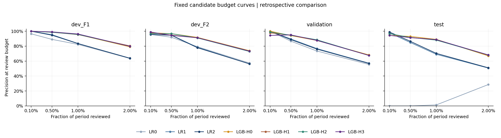
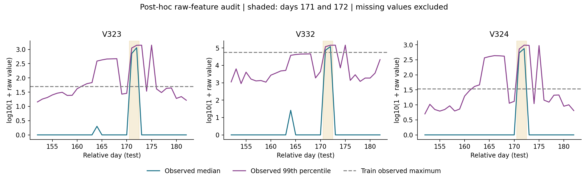
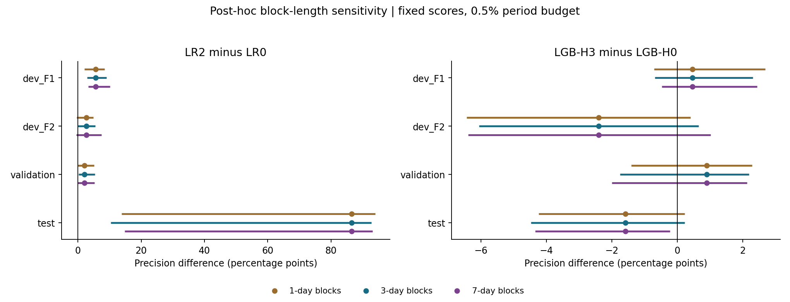

# 支付欺诈排序的时间稳定性与特征改进评估

DSC5001新版课程作业报告｜实测版｜2026年11月21日

## 摘要

本项目在有限审核容量下评价支付欺诈排序，重点研究数值处理、历史特征和日期分布如何影响模型结论。使用IEEE-CIS有标签交易表590,540笔交易、394列、20,663笔欺诈，设置两个28天开发评价期，并对原验证与测试期作回顾性比较。固定七配置、三个训练快照，共21次核心拟合；全部逻辑回归收敛。全期0.5%审核预算下，测试期原逻辑回归margin排序命中0/443，经训练期分位数截尾后为376/443，结合更强正则化后为383/443；基础LightGBM为412/443，历史增强版H3为405/443。历史增益随时期反转，未显示稳定正收益。新增394列质量审计和块长/日期影响分析进一步显示：极端输入和少数日期会显著影响排序及每日名额比较。所有结论限于观察数据和假设预算，不解释为长期人力最优配置或真实财务收益。

## 1. 研究问题与相对原方案的贡献

原方案已经包含时间切分、训练期预处理、严格历史统计、固定Top-K评价、LR失效讨论和本地服务原型。新版保留这些基础，集中补充可重复的对照证据，回答三个问题：

1. 固定审核比例下，不同模型的排序结论是否跨时期、跨预算保持？
2. 训练期截尾与更强正则化，分别为逻辑回归带来什么变化？
3. 修正缺失实体处理、增加近期历史，是否稳定改善基础LightGBM？

每日8/16/32笔是补充的日末批处理场景。新版不研究跨日动态排班。全部改进及与原方案对应关系见[原方案改进对照](原方案改进对照.md)。

## 2. 数据与时间设计

原数据保持不变。交易ID、标签与原始切分时间不进入模型；identity只做覆盖审计。数据共有182个相对日桶，交易量与日期量分别报告。

| 评价期 | 训练笔数 | 评价笔数 | 欺诈数 | 日桶数 | 0.5%名额 |
|---|---:|---:|---:|---:|---:|
| dev_F1 | 223,738 | 85,610 | 3,478 | 28 | 429 |
| dev_F2 | 309,348 | 91,732 | 3,507 | 28 | 459 |
| validation | 413,378 | 88,581 | 3,042 | 33 | 443 |
| test | 413,378 | 88,581 | 3,083 | 31 | 443 |

开发期评价日窗为[61,89)、[89,117)，评价期互不重叠，但后期训练包含前期数据，因此不能视为独立重复样本。原验证和测试使用同一个原训练快照，避免将该对比中的变化混同为重训影响。历史标签假定在训练截点已可用，缺少真实标签到达时间。原测试已被查看，所有比较均标注回顾性；固定候选不能将其重新变成盲测。

## 3. 方法与评价口径

LR0为原数值处理、C=1；LR1仅增加训练期0.1%–99.9%分位数截尾；LR2在LR1基础上改为C=0.1。三者以decision_function排序，同时保留概率诊断。LGB-H0为基础LightGBM；H1增加四个累计历史字段并沿用缺失实体共享组；H2仅修正该缺失处理；H3再增加card1和addr1各自的24小时次数和距上笔时间。模型参数固定，没有大范围搜索。

逐值规范化保证123、123.0及其字符串形式一致。同时间戳整组计算后再更新历史，严格使用<t信息；24小时窗为[t−86400,t)，不用标签。未知实体并非已验证的真实身份。预处理阈值、编码、填补与缩放只在训练期拟合。

主预算为全期0.5%，并完整报告0.1%、1%、2%及旧Top100/500口径。命中数、精确率和召回率为主指标，AP为补充；AP指average_precision_score，不混称梯形PR曲线面积。随机基线以同容量条件期望为主，保留seed42示例。每日预算向上取整后与全期对照匹配实际总名额。

主要对照为LR2−LR0和H3−H0；分解截尾、正则化与历史构成的对照均完整保留。主分析使用1000次配对3日移动块重采样，区间只条件于固定模型与观察日期，不含训练不确定性，也不校正诊断比较的多重性。

## 4. 全期0.5%审核结果

| 期别 | 配置 | 命中/名额 | 精确率 | 召回率 | AP |
|---|---|---:|---:|---:|---:|
| dev_F1 | LR0 | 382/429 | 89.04% | 10.98% | 0.415662 |
| dev_F1 | LR1 | 409/429 | 95.34% | 11.76% | 0.430635 |
| dev_F1 | LR2 | 406/429 | 94.64% | 11.67% | 0.428690 |
| dev_F1 | LGB-H0 | 423/429 | 98.60% | 12.16% | 0.570886 |
| dev_F1 | LGB-H1 | 423/429 | 98.60% | 12.16% | 0.580330 |
| dev_F1 | LGB-H2 | 423/429 | 98.60% | 12.16% | 0.573498 |
| dev_F1 | LGB-H3 | 425/429 | 99.07% | 12.22% | 0.572330 |
| dev_F2 | LR0 | 422/459 | 91.94% | 12.03% | 0.399065 |
| dev_F2 | LR1 | 435/459 | 94.77% | 12.40% | 0.400653 |
| dev_F2 | LR2 | 434/459 | 94.55% | 12.38% | 0.396826 |
| dev_F2 | LGB-H0 | 444/459 | 96.73% | 12.66% | 0.539534 |
| dev_F2 | LGB-H1 | 435/459 | 94.77% | 12.40% | 0.524963 |
| dev_F2 | LGB-H2 | 444/459 | 96.73% | 12.66% | 0.528232 |
| dev_F2 | LGB-H3 | 433/459 | 94.34% | 12.35% | 0.529982 |
| validation | LR0 | 384/443 | 86.68% | 12.62% | 0.399725 |
| validation | LR1 | 397/443 | 89.62% | 13.05% | 0.417646 |
| validation | LR2 | 393/443 | 88.71% | 12.92% | 0.414950 |
| validation | LGB-H0 | 417/443 | 94.13% | 13.71% | 0.523112 |
| validation | LGB-H1 | 420/443 | 94.81% | 13.81% | 0.523541 |
| validation | LGB-H2 | 419/443 | 94.58% | 13.77% | 0.523941 |
| validation | LGB-H3 | 421/443 | 95.03% | 13.84% | 0.518156 |
| test | LR0 | 0/443 | 0.00% | 0.00% | 0.177987 |
| test | LR1 | 376/443 | 84.88% | 12.20% | 0.365346 |
| test | LR2 | 383/443 | 86.46% | 12.42% | 0.369506 |
| test | LGB-H0 | 412/443 | 93.00% | 13.36% | 0.499573 |
| test | LGB-H1 | 405/443 | 91.42% | 13.14% | 0.497879 |
| test | LGB-H2 | 406/443 | 91.65% | 13.17% | 0.499497 |
| test | LGB-H3 | 405/443 | 91.42% | 13.14% | 0.497343 |

| 期别 | LR2−LR0命中差及95%区间 | H3−H0命中差及95%区间 |
|---|---:|---:|
| dev_F1 | +24 [12.98, 38.02] | +2 [-3.00, 10.00] |
| dev_F2 | +12 [0.00, 27.00] | -11 [-28.00, 3.00] |
| validation | +9 [1.00, 24.00] | +4 [-8.00, 10.00] |
| test | +383 [45.95, 418.00] | -7 [-20.00, 1.00] |

训练期截尾明显缓解LR的后期退化。LR2相对LR1的命中差依次为−3、−1、−4、+7，因此不能只凭测试期提升宣称更强正则化稳定有效。LR0概率排序测试期为6/443，而margin排序为0/443：解除概率饱和没有自动修复底层线性排序。

H3相对H0的主预算差异依次为+2、−11、+4、−7，主分析区间均跨0，不能宣称稳定提升，也不能据此证明两者等价。AP与队列前端命中关注不同排序区域，需结合报告。基础LightGBM表现良好不意味着该模型在未观测时期必然稳健。

## 5. 质量审计与LR退化解释

新增审计逐列描述全部394列的训练、验证、测试缺失率、唯一值、常量、非有限值、分位数及超出训练范围的计数；类别列另记未知值。V323训练最大49、测试最大1411；V324由33变为976。V323在第171/172日有值中位数为733，其他测试日为0。某些字段的缺失率也明显变化，例如M8测试较训练下降约28.29个百分点。

已有模型贡献分解显示，LR0测试最高分443笔全部误报，其中442笔来自第171/172日；V323等字段有巨大正贡献，另一些字段存在巨大负向抵消。贡献重构误差小于7×10⁻¹³。分布、得分贡献与日期集中度共同支持极端输入关联的解释，但匿名语义、字段相关性与未做因果干预限制了原因识别。

排除ID和标签、保留时间时，发现3组共6笔相同输入，均未跨原分区；再排除时间后，发现1215组、共2718笔，其中399组跨分区、17组标签不一致。这些组合不必然是同一交易，不能直接断言泄漏或标注错误。没有自动去重或测试后筛列。

## 6. 块长与日期影响

补充分析完整计算1/3/7日块，并遍历每期全部连续1/2/7日省略窗，共332个场景。原3日分析保留，新增分析明确为事后。LR2−LR0测试期区间在三种块长均为正，但开发F2及验证部分设置触及或跨0。H3−H0测试期的1/3/7日块区间分别为[−19,1]、[−20,1]、[−19,−1]，说明具体统计判断对设定敏感；整体仍不支持历史特征的稳定正收益。

省略第171/172日后，LR0为275/414、LR2为362/414，H0为389/414、H3为383/414。异常日解释了部分差距，但LR修复的剩余增量仍有87笔。该分析只过滤评价行，历史和模型均固定，不能当作删除困难数据后得到的更好主实验。完整日窗结果与更多指标见[补充分析结果](../evidence/supplement_20261121_01/补充分析结果.md)。

## 7. 每日有限名额的补充场景

测试期每日16笔共496笔，使用同样496笔的全期排序作比较：

| 配置 | 每日命中 | 同容量全期命中 | 每日减全期及3日块95%区间 |
|---|---:|---:|---:|
| LR0 | 301 | 0 | +301 [-38.00, 341.02] |
| LR2 | 369 | 422 | -53 [-79.00, -23.00] |
| LGB-H0 | 435 | 461 | -26 [-38.00, -12.00] |
| LGB-H3 | 431 | 455 | -24 [-34.00, -8.00] |

每日容量限制减少了少数异常日期占据LR0全部名额的程度，但其主区间跨0；对其他模型则减少命中。省略第171/172日后，LR0每日相对全期从+301变为−8，进一步显示该现象依赖日期组成。每日策略不能概括为普适改善。

测试期每天0.5%取整共458笔，全期0.5%为443笔；新版已匹配容量，避免把多审核15笔的效果误归因于策略。8/16/32均无真实团队容量依据。59万行足以观察明显排序退化，但测试只有31个日桶，不足以保证识别几笔命中的细微差异或长期人力规律。

## 8. 复现、证据与原报告处理

主实验状态verified：独立复算36组时期×配置、4320组每日评价和76995条队列记录；10项正确性测试覆盖规范化、历史、边界、分块、截尾、排序、重采样与保存加载。补充分析与原分数对齐28组，独立直接过滤和排序检查259组省略结果。全列缺失率和重点分位数另作独立复算。

原代码另完成3次重跑：基础LightGBM复现归档至1e−10容差；旧LR及旧历史版部分数值略变，原值和环境差异全部保留，尚未逐项隔离依赖影响。当前原代码与新版共同基线在两后期的六组逐笔margin/概率均在1e−10容差内一致。

新建不继承系统包的独立环境，完成锁定主要依赖安装、pip check、10项测试和合成端到端核验；完整真实数据没有在该环境再次拟合。主实验实际环境与独立安装环境的完整依赖分别保留，不宣称所有平台结果逐位一致。

旧Word记载的部分CV、PDP、置换重要性、子群分析及共享附录缺少完整可执行证据，本报告不继承其数值结论。原HTTP/Java原型作为原项目工程扩展保留，新版验收聚焦离线评分、历史与队列一致性。

## 9. 讨论与局限

本作业的主要贡献是将失效现象转成受控对照、把历史特征收益拆解成可检验增量，并用不确定性和日期影响约束结论。增加复杂特征没有稳定获益本身就是有效研究结果。

仍缺乏新的未查看时期、标签成熟时间、上游匿名字段定义、真实调查结果和审核成本。日期相关、实体相关、训练长度变化与有限时间跨度均限制外推。没有概率校准、财务收益、因果机制或生产可用性证据。增加重采样次数不会产生新月份。下一步优先获取真正新的带标签时期，并按事前协议评价，而不是继续按已有测试结果加模型。

## 研究图表

图1展示全部预定预算的结果；图2和图3为事后补充分析。

图1：固定候选的审核预算曲线。

图2：关键匿名字段的测试期每日分布。

图3：不同块长下的主要差异区间。
## 参考资料与附录

本报告沿用原方案的数据与方法出处；未新增系统性文献综述。

1. Kaggle. IEEE-CIS Fraud Detection. 2019. 数据来源沿用原项目记录。
2. Ke, G., et al. LightGBM: A Highly Efficient Gradient Boosting Decision Tree. NeurIPS, 2017.
3. Saito, T., and Rehmsmeier, M. The Precision-Recall Plot Is More Informative than the ROC Plot When Evaluating Binary Classifiers on Imbalanced Datasets. PLOS ONE, 2015. DOI: 10.1371/journal.pone.0118432. 此文是原项目指标选择的参考，不代替本项目的统计验证。

可复算依据：[主实验汇总](../evidence/executed_summary.json)、[冻结方案](../configs/study_plan.json)、[补充配置](../configs/supplement_plan.json)、[补充分析](../evidence/supplement_20261121_01/补充分析结果.md)、[复现指南](复现指南.md)。报告由scripts/build_report.py从实际结果生成，来源与输出哈希见补充目录report_manifest.json。
